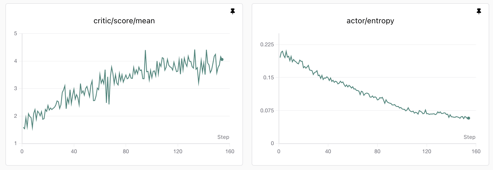

# 🚀 AgentSTAR RL

This README explains how to use the RL code under this directory. The repository contains two main parts:

- **Training**: TravelPlanner-oriented RL training, including local sandbox tools, rewards, training scripts, logging, and checkpoint export.

- **OOD Inference**: evaluation on out-of-domain retrieval-style tasks, including BrowseComp-Plus and Knowledge-Intensive QA.

  

## 🏋️ Training

### 1. Environment Setup

Create and activate the environment:

```shell
conda create -n rllm_0511 python=3.10
conda activate rllm_0511
```

Install dependencies from the `RL` directory:

```shell
cd /PATH/TO/RL
bash scripts/install_verl.sh
pip install -e .
pip install swanlab
```

You can compare your environment with `rllm_env.txt`


### 2. Code Preparation

TravelPlanner uses local tools backed by a local sandbox database. Before training, check the database paths and API configuration.

#### 🔧 Local Sandbox Database

The TravelPlanner tools read from:

```text
rllm/tools/travel_tools/database/
```

The CSV files are **not shipped in this repository**. Download the [travel database](https://huggingface.co/datasets/xxwu/Agent-STAR-TravelDatabase) and put all CSVs there before training:

```text
rllm/tools/travel_tools/database/
├── attractions.csv
├── clean_Flights_2022.csv
├── clean_accommodations_2022.csv
├── clean_restaurant_2022.csv
├── distance.csv
└── background/          # already included
```

Important files:

| Component | File |
| --- | --- |
| Commonsense reward checks | `rllm/rewards/travel_utils/eval_commonsense.py` |
| Hard-constraint reward checks | `rllm/rewards/travel_utils/eval_hardconstraint.py` |
| Travel tools | `rllm/tools/travel_tools/*` |

Most database paths are relative by default and can be overridden through environment variables such as `FLIGHT_PATH`, `CITY_PATH`, `ATTRACTION_PATH`, `RESTAURANT_PATH`, and `ACCOMMODATION_PATH`.

#### 🔑 API Configuration

| API | Where to configure |
| --- | --- |
| DeepSeek reward formatter | `rllm/rewards/travel_reward.py` and `rllm/rewards/travel_ood_reward.py`; preferably set `DEEPSEEK_API_KEY` through the environment. |
| SwanLab logging | Training scripts under `examples/travel/*_scripts/`; set `SWANLAB_API_KEY`. |
| Local vLLM server | Inference scripts use an OpenAI-compatible local endpoint; usually no real key is needed. |

Reward smoke test:

```shell
export DEEPSEEK_API_KEY="YOUR_DEEPSEEK_API_KEY"
python3 -m rllm.rewards.travel_reward
```

Tool smoke tests:

```shell
python3 -m rllm.tools.travel_tools.search_restaurant
python3 -m rllm.tools.travel_tools.search_city
python3 -m rllm.tools.travel_tools.search_flight
python3 -m rllm.tools.travel_tools.search_accommodation
python3 -m rllm.tools.travel_tools.search_attraction
python3 -m rllm.tools.travel_tools.google_distance
```


### 3. Models and Data

Initial SFT checkpoints:

| Model | Hugging Face path |
| --- | --- |
| SFT-1.5B | `xxwu/Agent-STAR-SFT-1.5B` |
| SFT-3B | `xxwu/Agent-STAR-SFT-3B` |
| SFT-7B | `xxwu/Agent-STAR-SFT-7B` |

Default TravelPlanner data:

| Split | Path |
| --- | --- |
| Train | `rllm/data/travel_1107_1K_E4M3H3_1212.jsonl` |
| Validation | `rllm/data/travel_val180.jsonl` |


### 4. Training Scripts

Training scripts are organized by model size:

```text
examples/travel/1_5b_scripts/
examples/travel/3b_scripts/
examples/travel/7b_scripts/
```

A representative 3B script is:

```shell
examples/travel/3b_scripts/train_qwen2_5_sft_3b_curriculum.sh
```

#### ✅ 6 Steps Before Launch

**Step 1: Set the RL root**

```shell
cd /PATH/TO/RL
mkdir -p logs
```

**Step 2: Activate the RL environment**

```shell
conda activate rllm_0511
```

**Step 3: Set the initial checkpoint**

```shell
export TRAINING_MODEL="/PATH/TO/MODEL"
export TRAINING_MODEL_NAME=$(basename "$TRAINING_MODEL")
```

**Step 4: Set data paths**

```shell
export TRAIN_DATA="rllm/data/travel_1107_1K_E4M3H3_1212.jsonl"
export TEST_DATA="rllm/data/travel_val180.jsonl"
export TRAIN_DATA_NAME="travel_1107_1K_E4M3H3_1212"
export TEST_DATA_NAME="travel_val180"
```

If you change `TRAIN_DATA`, also update `TRAIN_DATA_NAME`.

**Step 5: Set tools and reward**

```shell
export AGENT_TOOLS="SearchFlight,SearchCity,SearchAttraction,SearchRestaurant,SearchAccommodation,GoogleDistanceMatrix"
export ENV_TOOLS="SearchFlight,SearchCity,SearchAttraction,SearchRestaurant,SearchAccommodation,GoogleDistanceMatrix"

export REWARD_TYPE="PLANNER_R1" # the staged Curriculum reward
export TOTAL_STEPS=154          # Required by the Curriculum reward; stage boundaries are current_step / TOTAL_STEPS
# export REWARD_TYPE="SUM"      # dense
# export REWARD_TYPE="MACRO"    # semi-sparse
# export REWARD_TYPE="SUCCESS"  # sparse
```

**Step 6: Set logging and output**

```shell
export SWANLAB_API_KEY="YOUR_SWANLAB_API_KEY"
export PROJECT_NAME="TravelPlanner_3B_Reward"
export EXPERIMENT_NAME="NEW_EXPERIMENT_NAME"
export SAVE_PATH="/PATH/TO/SAVE_PATH/${EXPERIMENT_NAME}"
```

Launch training:

```shell
bash examples/travel/3b_scripts/train_qwen2_5_sft_3b_curriculum.sh
```


#### ⚙️ Variable Cheat Sheet

Most defaults in the scripts are ready to use. Start by changing paths, reward type, experiment names, and resource-related parallelism.

| Variable | What it controls | Typical action |
| --- | --- | --- |
| `TRAINING_MODEL` | Initial SFT checkpoint | **Set this** |
| `TRAIN_DATA`, `TEST_DATA` | Train/validation data | **Check or update** |
| `REWARD_TYPE` | Reward design: `PLANNER_R1` (Curriculum), `SUM`, `MACRO`, or `SUCCESS` | **Choose per run** |
| `TOTAL_STEPS` | Curriculum schedule length | **Required for `PLANNER_R1`** |
| `PROJECT_NAME`, `EXPERIMENT_NAME`, `SAVE_PATH` | Logging and checkpoints | **Set these** |
| `SWANLAB_API_KEY` | SwanLab logging | Set if using SwanLab |
| `BATCH_SIZE`, `MINI_BATCH_SIZE`, `N` | GRPO batch/group settings | Usually keep default first |
| `MAX_NEW_TOKEN`, `MAX_PPO_TOKEN` | Long-response token budget | Tune only if needed |
| `TP_SIZE`, `SP_SIZE`, `N_NODES` | Parallelism | Match your GPU setup |
| `AGENT_MAX_STEPS`, `ENV_MAX_STEPS` | Max tool-use steps | Usually `60` |
| `OVERLONG_FILTER`, `TRAJECTORY_TIMEOUT` | Long-trajectory controls | Usually keep default |

Optional algorithm switches:

```shell
# ARPO
export ARPO=True

# DAPO: add this to the Python command
rllm.rejection_sample.enable=True
```

Optional tool-call noise:

```shell
export TOOL_CALL_ERROR=True
export TOOL_CALL_ERROR_PERCENTAGE=0.01
```


### 5. Training Dynamics

SwanLab records:

- validation scores;
- trajectory end states such as `ENV_DONE` and `TRUNCATION`;
- average tool-call frequency;
- reward, entropy, and other training curves.



Local logs are saved to:

```text
logs/${EXPERIMENT_NAME}_${TIMESTAMP}.log
```


### 6. Checkpoint Export

Convert a saved actor checkpoint to Hugging Face format:

```shell
cd helper
python3 convert_safetensor.py --local_dir /PATH/TO/SAVE_FOLDER/global_step_140/actor
```

The exported model will be under:

```text
/PATH/TO/SAVE_FOLDER/global_step_140/actor/huggingface
```


## 🌐 OOD Inference

### 1. BrowseComp-Plus

BrowseComp-Plus code lives in:

```text
examples/deepresearch/
```

`scripts/run_inference.sh` uses 3 runtime environments:

- **Retrieval server**: use a LLaMAFactory-style environment with `Flask==3.1.2` and `faiss==1.8.0`
- **Model serving**: use the inference-serving environment, e.g. `vllm==0.11.0`, `transformers==4.57.3`, `torch==2.8.0`. The rLLM environment can also serve models if you keep its installed vLLM stack.
- **Benchmark inference**: use the rLLM environment created above.


#### Download Indexes and Corpus

From `examples/deepresearch`, download indexes:

```shell
# huggingface-cli download Tevatron/browsecomp-plus-indexes --repo-type=dataset --include="bm25/*" --local-dir ./indexes
# huggingface-cli download Tevatron/browsecomp-plus-indexes --repo-type=dataset --include="qwen3-embedding-0.6b/*" --local-dir ./indexes
# huggingface-cli download Tevatron/browsecomp-plus-indexes --repo-type=dataset --include="qwen3-embedding-4b/*" --local-dir ./indexes
huggingface-cli download Tevatron/browsecomp-plus-indexes --repo-type=dataset --include="qwen3-embedding-8b/*" --local-dir ./indexes
```

Download corpus:

```shell
huggingface-cli download Tevatron/browsecomp-plus-corpus --repo-type=dataset --local-dir ./corpus
```

Expected folders:

```text
examples/deepresearch/corpus/
examples/deepresearch/data/
examples/deepresearch/indexes/
```


#### Run Inference

> **Before the first run**, edit the two hard-coded `cd /PATH/TO/RL...` lines inside
> `examples/deepresearch/scripts/run_inference.sh` (lines 70 and 123) and inside
> `examples/deepresearch/scripts/launch_server.sh` (line 4) to point at your own `RL` directory.

```shell
bash examples/deepresearch/scripts/run_inference.sh \
  /PATH/TO/MODEL 8001 6001 Sum_7B_2K
```

Arguments are `[MODEL_PATH] [SERVER_PORT] [VLLM_PORT] [SAVE_PREFIX]`.

The script starts both the retrieval server and vLLM server. By default it expects **at least 2 available GPUs**: GPU 0 for the retrieval server and GPU 1 for inference (`--tensor-parallel-size 1`).

Useful knobs:

- retrieval top-$k$: `LocalRetrievalTool.self.max_results`;
- per-document truncation length: currently hard-coded in the retrieval tool.


### 2. Knowledge-Intensive QA

SearchQA-style code lives in:

```text
examples/searchqa/
```

#### Download Corpus and Index

```shell
cd examples/searchqa
python3 download_search_data.py --data_dir ./search_data
```

This downloads:

- Wikipedia corpus from `PeterJinGo/wiki-18-corpus`;
- E5 dense index from `PeterJinGo/wiki-18-e5-index`.


#### Run Inference

> **Before the first run**, edit the two hard-coded `cd /PATH/TO/RL...` lines inside
> `examples/searchqa/scripts/run_inference.sh` (lines 68 and 119) to point at your own `RL` directory.

```shell
bash examples/searchqa/scripts/run_inference.sh \
  /PATH/TO/MODEL 8001 6001 Sum_7B_2K
```

Arguments are `[MODEL_PATH] [RETRIEVAL_PORT] [VLLM_PORT] [SAVE_PREFIX]`. Note that the usage
comment at the top of the script mislabels the 4th argument as `DATA_DIR`; the code uses it as
`SAVE_PREFIX`, and the retrieval `--data_dir` is fixed to `./search_data/prebuilt_indices`.

This script needs **at least 2 GPUs**: vLLM is launched on GPUs 0 and 1 with
`--tensor-parallel-size 2`, and the retrieval server shares the same devices.

The script evaluates datasets including `nq`, `triviaqa`, `popqa`, `hotpotqa`, `2wikimultihopqa`, `musique`, and `bamboogle`.

Trajectories and logs are written to `examples/searchqa/output_traj/${SAVE_PREFIX}/` and
`examples/searchqa/logs/${SAVE_PREFIX}/`, both of which are git-ignored.
