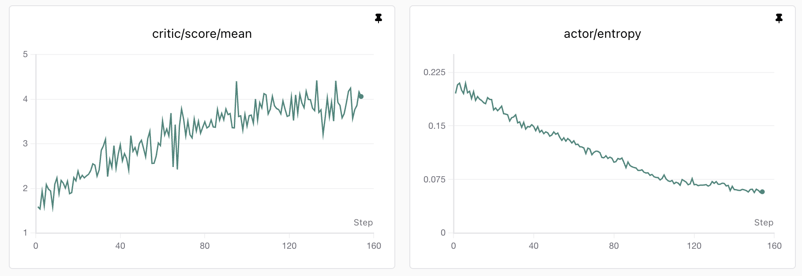

# 🚀 AgentSTAR RL

这个 README 说明如何使用 `RL/` 下的强化学习代码。整体分成两部分：

- **Training**：围绕 TravelPlanner 的 RL 训练，包括本地 sandbox tools、reward、训练脚本、日志和 checkpoint 导出。
- **OOD Inference**：在分布外检索任务上做推理，包括 BrowseComp-Plus 和 Knowledge-Intensive QA。


## 🏋️ Training

### 1. 环境准备

创建并激活环境：

```shell
conda create -n rllm_0511 python=3.10
conda activate rllm_0511
```

在 `RL` 目录下安装依赖：

```shell
cd /PATH/TO/RL
bash scripts/install_verl.sh
pip install -e .
pip install swanlab
```

可以和`rllm_env.txt`文件对照环境


### 2. 代码准备

TravelPlanner 使用本地工具和本地 sandbox database。训练前主要检查数据库路径和 API 配置。

#### 🔧 Local Sandbox Database

TravelPlanner 工具读取：

```text
rllm/tools/travel_tools/database/
```

CSV 文件**不随仓库分发**，训练前需要先下载 [travel database](https://huggingface.co/datasets/xxwu/Agent-STAR-TravelDatabase) 并把所有 CSV 放进该目录：

```text
rllm/tools/travel_tools/database/
├── attractions.csv
├── clean_Flights_2022.csv
├── clean_accommodations_2022.csv
├── clean_restaurant_2022.csv
├── distance.csv
└── background/          # 仓库已包含
```

重点文件：

| 模块 | 文件 |
| --- | --- |
| Commonsense reward 检查 | `rllm/rewards/travel_utils/eval_commonsense.py` |
| Hard-constraint reward 检查 | `rllm/rewards/travel_utils/eval_hardconstraint.py` |
| Travel tools | `rllm/tools/travel_tools/*` |

大多数数据库路径默认是相对路径，也可以通过环境变量覆盖，例如 `FLIGHT_PATH`、`CITY_PATH`、`ATTRACTION_PATH`、`RESTAURANT_PATH`、`ACCOMMODATION_PATH`。

#### 🔑 API 配置

| API | 配置位置 |
| --- | --- |
| DeepSeek reward formatter | `rllm/rewards/travel_reward.py` 和 `rllm/rewards/travel_ood_reward.py`；推荐通过环境变量设置 `DEEPSEEK_API_KEY`。 |
| SwanLab logging | `examples/travel/*_scripts/` 下的训练脚本；设置 `SWANLAB_API_KEY`。 |
| Local vLLM server | 推理脚本使用 OpenAI-compatible local endpoint；通常不需要真实 key。 |

Reward 测试：

```shell
export DEEPSEEK_API_KEY="YOUR_DEEPSEEK_API_KEY"
python3 -m rllm.rewards.travel_reward
```

工具测试：

```shell
python3 -m rllm.tools.travel_tools.search_restaurant
python3 -m rllm.tools.travel_tools.search_city
python3 -m rllm.tools.travel_tools.search_flight
python3 -m rllm.tools.travel_tools.search_accommodation
python3 -m rllm.tools.travel_tools.search_attraction
python3 -m rllm.tools.travel_tools.google_distance
```


### 3. 模型和数据

初始 SFT checkpoint：

| Model | Hugging Face path |
| --- | --- |
| SFT-1.5B | `xxwu/Agent-STAR-SFT-1.5B` |
| SFT-3B | `xxwu/Agent-STAR-SFT-3B` |
| SFT-7B | `xxwu/Agent-STAR-SFT-7B` |

默认 TravelPlanner 数据：

| Split | Path |
| --- | --- |
| Train | `rllm/data/travel_1107_1K_E4M3H3_1212.jsonl` |
| Validation | `rllm/data/travel_val180.jsonl` |


### 4. 训练脚本

训练脚本按照模型大小组织：

```text
examples/travel/1_5b_scripts/
examples/travel/3b_scripts/
examples/travel/7b_scripts/
```

一个典型的 3B 脚本是：

```shell
examples/travel/3b_scripts/train_qwen2_5_sft_3b_curriculum.sh
```

#### ✅ 启动前的 6 个步骤

**Step 1：设置 RL 根目录**

```shell
cd /PATH/TO/RL
mkdir -p logs
```

**Step 2：激活环境**

```shell
conda activate rllm_0511
```

**Step 3：设置初始 checkpoint**

```shell
export TRAINING_MODEL="/PATH/TO/MODEL"
export TRAINING_MODEL_NAME=$(basename "$TRAINING_MODEL")
```

**Step 4：设置数据路径**

```shell
export TRAIN_DATA="rllm/data/travel_1107_1K_E4M3H3_1212.jsonl"
export TEST_DATA="rllm/data/travel_val180.jsonl"
export TRAIN_DATA_NAME="travel_1107_1K_E4M3H3_1212"
export TEST_DATA_NAME="travel_val180"
```

如果修改 `TRAIN_DATA`，也同步修改 `TRAIN_DATA_NAME`。

**Step 5：设置工具和 reward**

```shell
export AGENT_TOOLS="SearchFlight,SearchCity,SearchAttraction,SearchRestaurant,SearchAccommodation,GoogleDistanceMatrix"
export ENV_TOOLS="SearchFlight,SearchCity,SearchAttraction,SearchRestaurant,SearchAccommodation,GoogleDistanceMatrix"

export REWARD_TYPE="PLANNER_R1" # 分阶段的 Curriculum reward
export TOTAL_STEPS=154          # Curriculum reward 必需：阶段边界按 current_step / TOTAL_STEPS 划分
# export REWARD_TYPE="SUM"      # dense
# export REWARD_TYPE="MACRO"    # semi-sparse
# export REWARD_TYPE="SUCCESS"  # sparse
```

**Step 6：设置日志和输出路径**

```shell
export SWANLAB_API_KEY="YOUR_SWANLAB_API_KEY"
export PROJECT_NAME="TravelPlanner_3B_Reward"
export EXPERIMENT_NAME="NEW_EXPERIMENT_NAME"
export SAVE_PATH="/PATH/TO/SAVE_PATH/${EXPERIMENT_NAME}"
```

启动训练：

```shell
bash examples/travel/3b_scripts/train_qwen2_5_sft_3b_curriculum.sh
```


#### ⚙️ 变量速查

脚本里的大多数默认值可以直接先用。优先修改路径、reward、实验名、保存路径，以及和机器资源相关的并行参数。

| Variable | 控制什么 | 通常怎么处理 |
| --- | --- | --- |
| `TRAINING_MODEL` | 初始 SFT checkpoint | **必须设置** |
| `TRAIN_DATA`, `TEST_DATA` | 训练/验证数据 | **检查或修改** |
| `REWARD_TYPE` | Reward 设计：`PLANNER_R1`（Curriculum）、`SUM`、`MACRO`、`SUCCESS` | **按实验选择** |
| `TOTAL_STEPS` | Curriculum 的调度长度 | **`PLANNER_R1` 必需** |
| `PROJECT_NAME`, `EXPERIMENT_NAME`, `SAVE_PATH` | 日志和 checkpoint | **必须设置** |
| `SWANLAB_API_KEY` | SwanLab 日志 | 使用 SwanLab 时设置 |
| `BATCH_SIZE`, `MINI_BATCH_SIZE`, `N` | GRPO batch/group 设置 | 先用默认 |
| `MAX_NEW_TOKEN`, `MAX_PPO_TOKEN` | 长轨迹 token budget | 需要时再调 |
| `TP_SIZE`, `SP_SIZE`, `N_NODES` | 并行配置 | 根据 GPU 调整 |
| `AGENT_MAX_STEPS`, `ENV_MAX_STEPS` | 最大工具交互步数 | 通常 `60` |
| `OVERLONG_FILTER`, `TRAJECTORY_TIMEOUT` | 长轨迹稳定性控制 | 通常保持默认 |

可选算法开关：

```shell
# ARPO
export ARPO=True

# DAPO：加入 Python 启动命令
rllm.rejection_sample.enable=True
```

可选工具噪音实验：

```shell
export TOOL_CALL_ERROR=True
export TOOL_CALL_ERROR_PERCENTAGE=0.01
```


### 5. 训练动态

SwanLab 会记录：

- validation 分数；
- 轨迹结束状态，例如 `ENV_DONE`、`TRUNCATION`；
- 平均工具调用次数；
- reward、entropy 等训练曲线。



本地日志保存到：

```text
logs/${EXPERIMENT_NAME}_${TIMESTAMP}.log
```


### 6. Checkpoint 导出

把 actor checkpoint 转成 Hugging Face 格式：

```shell
cd helper
python3 convert_safetensor.py --local_dir /PATH/TO/SAVE_FOLDER/global_step_140/actor
```

导出模型在：

```text
/PATH/TO/SAVE_FOLDER/global_step_140/actor/huggingface
```


## 🌐 OOD Inference

### 1. BrowseComp-Plus

BrowseComp-Plus 代码在：

```text
examples/deepresearch/
```

`scripts/run_inference.sh` 会用到三个运行环境：

- **Retrieval server**：使用 LLaMAFactory-style 环境，关键依赖为 `Flask==3.1.2` 和 `faiss==1.8.0`
- **模型部署**：使用推理部署环境，例如 `vllm==0.11.0`、`transformers==4.57.3`、`torch==2.8.0`。如果使用 rLLM 环境自带的 vLLM stack，也可以直接用 rLLM 环境部署
- **Benchmark inference**：使用前面创建的 rLLM 环境


#### 下载 Indexes 和 Corpus

在 `examples/deepresearch` 下下载 indexes：

```shell
# huggingface-cli download Tevatron/browsecomp-plus-indexes --repo-type=dataset --include="bm25/*" --local-dir ./indexes
# huggingface-cli download Tevatron/browsecomp-plus-indexes --repo-type=dataset --include="qwen3-embedding-0.6b/*" --local-dir ./indexes
# huggingface-cli download Tevatron/browsecomp-plus-indexes --repo-type=dataset --include="qwen3-embedding-4b/*" --local-dir ./indexes
huggingface-cli download Tevatron/browsecomp-plus-indexes --repo-type=dataset --include="qwen3-embedding-8b/*" --local-dir ./indexes
```

下载 corpus：

```shell
huggingface-cli download Tevatron/browsecomp-plus-corpus --repo-type=dataset --local-dir ./corpus
```

准备完成后应包含：

```text
examples/deepresearch/corpus/
examples/deepresearch/data/
examples/deepresearch/indexes/
```


#### 运行推理

> **首次运行前**，需要修改 `examples/deepresearch/scripts/run_inference.sh` 里写死的两处
> `cd /PATH/TO/RL...`（第 70、123 行），以及 `examples/deepresearch/scripts/launch_server.sh`
> 第 4 行，改成你自己的 `RL` 目录。

```shell
bash examples/deepresearch/scripts/run_inference.sh \
  /PATH/TO/MODEL 8001 6001 Sum_7B_2K
```

参数依次是 `[MODEL_PATH] [SERVER_PORT] [VLLM_PORT] [SAVE_PREFIX]`。

脚本会启动 retrieval server 和 vLLM server。默认需要 **至少 2 张可用 GPU**：GPU 0 跑 retrieval，GPU 1 跑推理（`--tensor-parallel-size 1`）。

常用调整：

- 检索 top-k：`LocalRetrievalTool.self.max_results`；
- 每个文档的截断长度：目前写在 retrieval tool 中。


### 2. Knowledge-Intensive QA

SearchQA-style 代码在：

```text
examples/searchqa/
```

#### 下载 Corpus 和 Index

```shell
cd examples/searchqa
python3 download_search_data.py --data_dir ./search_data
```

这会下载：

- Wikipedia corpus：`PeterJinGo/wiki-18-corpus`；
- E5 dense index：`PeterJinGo/wiki-18-e5-index`。


#### 运行推理

> **首次运行前**，需要修改 `examples/searchqa/scripts/run_inference.sh` 里写死的两处
> `cd /PATH/TO/RL...`（第 68、119 行），改成你自己的 `RL` 目录。

```shell
bash examples/searchqa/scripts/run_inference.sh \
  /PATH/TO/MODEL 8001 6001 Sum_7B_2K
```

参数依次是 `[MODEL_PATH] [RETRIEVAL_PORT] [VLLM_PORT] [SAVE_PREFIX]`。注意脚本顶部的 usage 注释
把第 4 个参数误写成了 `DATA_DIR`，代码里实际用作 `SAVE_PREFIX`；检索的 `--data_dir` 固定为
`./search_data/prebuilt_indices`。

这个脚本需要 **至少 2 张 GPU**：vLLM 在 GPU 0、1 上以 `--tensor-parallel-size 2` 启动，retrieval server 共用同样的设备。

脚本会评测 `nq`、`triviaqa`、`popqa`、`hotpotqa`、`2wikimultihopqa`、`musique`、`bamboogle` 等数据集。

轨迹和日志分别写到 `examples/searchqa/output_traj/${SAVE_PREFIX}/` 和
`examples/searchqa/logs/${SAVE_PREFIX}/`，这两个目录都已被 git 忽略。
